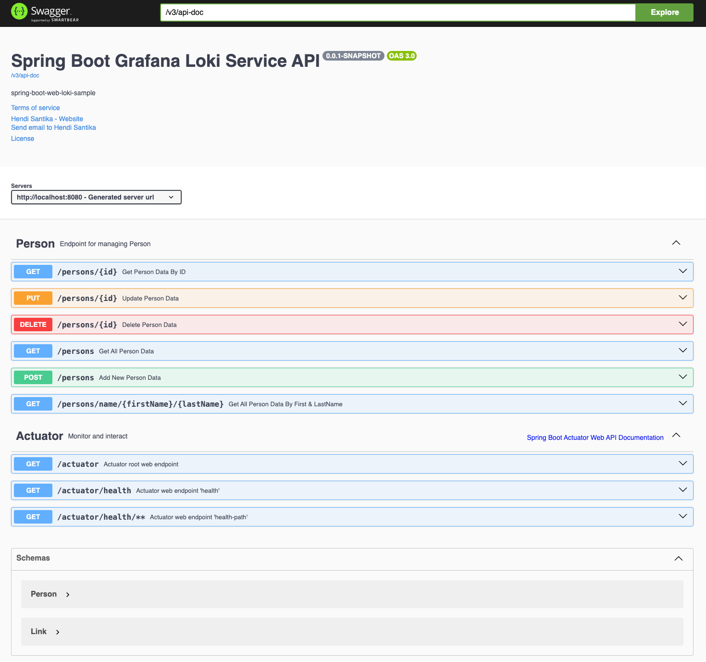
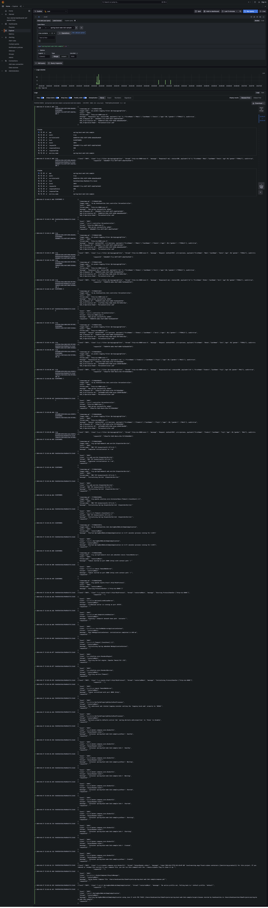

# spring-boot-web-loki-sample

[](https://github.com/hendisantika/spring-boot-web-loki-sample/actions/workflows/maven.yml)


[](.github/dependabot.yml)

Sample Spring Boot REST application that ships its logs to **Grafana Loki** using the
[loki-logback-appender](https://github.com/loki4j/loki-logback-appender) and
[loki-logging-spring-boot-starter](https://github.com/piomin/loki-logging-spring-boot-starter),
then visualizes them in **Grafana**.

## Tech Stack

| Component       | Version / Tool                                 |
|-----------------|------------------------------------------------|
| Java            | 25 (Temurin)                                   |
| Spring Boot     | 4.1.x (Web MVC, Actuator, Docker Compose)      |
| API Docs        | springdoc-openapi (Swagger UI)                 |
| Logging         | Logback + Loki4j appender                      |
| Observability   | Grafana Loki + Grafana                         |
| Testing         | JUnit 5, TestRestTemplate, Instancio, JaCoCo   |
| Build           | Maven Wrapper (`./mvnw`)                       |

## Prerequisites

- JDK 25
- Docker & Docker Compose (for Loki and Grafana)

## Things todo list

1. Clone this repository: `git clone https://github.com/hendisantika/spring-boot-web-loki-sample.git`
2. Navigate to the folder: `cd spring-boot-web-loki-sample`
3. Run the application: `./mvnw clean spring-boot:run`
   - Spring Boot Docker Compose support automatically starts Loki (`:3100`) and Grafana (`:3000`) from `compose.yml`.
   - Alternatively start them manually: `docker compose up -d`
4. Open your favorite browser: http://localhost:8080/swagger-ui
5. Open Grafana: http://localhost:3000 → **Explore** → data source **Loki** → query `{app="spring-boot-web-loki-sample"}`

## Build & Test

```shell
./mvnw clean package
```

The JaCoCo coverage report is generated at `target/site/jacoco/index.html`.

## Testing Logging on the Spring Boot REST App

After running the app, we can make some test calls of our REST API. In the beginning, let’s add some persons:

Add New Person

```shell
curl 'http://localhost:8080/persons' \
  -H 'Content-Type: application/json' \
  -d '{"firstName": "Itadori","lastName": "Yuji","age": 20,"gender": "MALE"}'
```

FEMALE

```shell
curl 'http://localhost:8080/persons' \
  -H 'Content-Type: application/json' \
  -d '{"firstName": "Shoko","lastName": "Ieri","age": 30,"gender": "FEMALE"}'

curl 'http://localhost:8080/persons' \
  -H 'Content-Type: application/json' \
  -d '{"firstName": "Maki","lastName": "Zenin","age": 30,"gender": "FEMALE"}'
```

Get All Persons

```shell
curl http://localhost:8080/persons
curl http://localhost:8080/persons/1
curl http://localhost:8080/persons/2
curl http://localhost:8080/persons/3
```

## CI/CD & Dependency Updates

- **GitHub Actions** (`.github/workflows/maven.yml`) builds and tests the project on JDK 25 for every push and pull request to `main`.
- **Dependabot** (`.github/dependabot.yml`) checks Maven dependencies daily and GitHub Actions weekly, grouping related updates (Spring Boot, springdoc, Loki, test libraries, Maven plugins) into single pull requests.

### Image Screenshot

Swagger UI



Grafana Loki


